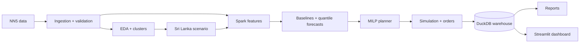

# ATM Cash Optimizer

[](https://github.com/vidurukalpana/atm-cash-optimizer/actions/workflows/ci.yml)

Bank-side cash planning for ATMs and cash recycler machines (CRMs). The system forecasts each
machine's cash demand as a range, plans the cheapest van visits and amounts per banknote with an
optimization model, and replays past days to compare that plan with the simple rules banks use
today.

## Results

Simulated over 280 days on a seeded sample of 10 machines per data set (first 14 days excluded),
every strategy under the same capacity, holiday, lead-time and emergency rules.

| Data set | Smart plan (forecast + optimizer) | Best simple rule | Cost saving | Days a machine ran empty |
|---|---|---|---|---|
| Sri Lanka (simulated, 6 ATMs + 4 CRMs) | LKR 10.36M | LKR 17.73M (refill below 20%) | **41.6%** | 0.83% vs 3.42% |
| UK ATMs (real NN5 data, 10 ATMs) | LKR 7.30M | LKR 11.31M (refill below 20%) | **35.4%** | 0.23% vs 0.00% |

Most of the saving comes from keeping less idle cash in the machines: the simple rules fill to the
top, the smart plan loads what the forecast says is needed, per banknote.

Forecast accuracy (mean absolute error of the 14-day total, withdrawals):

| Data set | LightGBM quantile model | Best baseline |
|---|---|---|
| Sri Lanka (simulated) | LKR 1.96M | LKR 2.26M (4-week weekday mean) |
| UK ATMs (real) | LKR 1.63M | LKR 1.52M (4-week weekday mean) |

On real data the median forecast does not beat the weekday mean; its value is the calibrated
range (q90 to q98) that the optimizer uses for safety stock. Full numbers:
`reports/results_<track>.md` and `reports/forecast_comparison_<track>.md`.

## How it works



1. **Forecast**: LightGBM predicts quantiles (q05 to q98) of each machine's total demand over
   the next 1 to 14 days, calibrated so that, for example, q95 really covers about 95% of days.
2. **Plan**: a mixed-integer model per machine chooses visit days and bundles per banknote at the
   lowest cost (visit fees, interest on idle cash, stockout penalty), respecting capacity,
   Poya and public holidays, and a one-day order lead time. CRMs can also have cash removed.
3. **Simulate**: every strategy replays the test period day by day, seeing only data up to that
   day.

Details: [docs/architecture.md](docs/architecture.md), and a plain-language guide in
[docs/PROJECT_GUIDE.md](docs/PROJECT_GUIDE.md).

## Quick start

Requires Python 3.11 and Java 17 (for the Spark step).

```bash
python3.11 -m venv .venv
source .venv/bin/activate
pip install -e ".[dev]"

python -m atm_cash_optimizer.run_all      # every step in order, about 20 min on 4 cores
streamlit run dashboard/app.py            # http://localhost:8501, stop with Ctrl+C
```

Or step by step:

| Step | Command | Time (4 cores) |
|---|---|---|
| Download and clean NN5 | `python -m atm_cash_optimizer.data.ingest` | seconds |
| Machine clusters | `python -m atm_cash_optimizer.analysis.clustering` | seconds |
| Sri Lanka scenario | `python -m atm_cash_optimizer.scenario.build` | seconds |
| Features (PySpark) | `python -m atm_cash_optimizer.features.build` | ~30 s |
| Baseline forecasts | `python -m atm_cash_optimizer.forecasting.baselines` | ~3 min |
| Quantile forecasts | `python -m atm_cash_optimizer.forecasting.train --track nn5` (then `lk`) | ~2.5 + 4.5 min |
| Simulation | `python -m atm_cash_optimizer.simulation.run --track nn5` (then `lk`) | ~1.5 + 3 min |

The forecasting and simulation commands accept `--timing N` to time a small part first without
writing anything. Experiment runs: `mlflow ui --backend-store-uri sqlite:///mlruns/mlflow.db`.

## Dashboard

```bash
streamlit run dashboard/app.py
```

Pages: **Overview**, **Cash Status** (every machine's cash and alerts), **Machine Insights**
(one machine's forecast range and cash history) and **Results** (strategy comparison). It only
reads saved results and labels the Sri Lanka data set as simulated.

## Project structure

```
configs/                 all tunable values (YAML, validated on load)
src/atm_cash_optimizer/
  data/                  NN5 download, parsing, imputation, validation
  analysis/              demand profiles, machine clustering
  scenario/              simulated Sri Lankan network (calendar, festivals, CRMs, banknotes)
  features/              PySpark origin-horizon features
  forecasting/           backtest, baselines, LightGBM quantiles, calibration, evaluation
  optimization/          MILP planner (PuLP + CBC)
  simulation/            policies, day-by-day replay, comparison
  run_all.py             every step in order
dashboard/               Streamlit app
docs/                    architecture, data, EDA, scenario, metrics, assumptions, plan
notebooks/  sql/         EDA notebook and queries
tests/                   pytest suite (Spark tests marked `spark`)
```

Generated data (`data/`, `reports/`, `mlruns/`) is not in git; the commands above rebuild it.

## Data and limitations

- **NN5** ([Zenodo 4656110](https://zenodo.org/records/4656110)) holds real withdrawals of 111 UK
  ATMs from 1996 to 1998, scaled to LKR with an assumed unit
  ([docs/data.md](docs/data.md)).
- **The Sri Lanka data set is simulated** from NN5: dates moved to 2024 to 2026, UK holidays
  removed, and Sri Lankan holidays, festivals (Avurudu, Vesak, …), location types, CRMs and
  banknote shares added by assumption ([docs/scenario.md](docs/scenario.md)). The forecast learns
  rules that the simulation put in, so its results there are optimistic; the NN5 results are the
  honest check.
- Costs, capacities and multipliers are placeholders ([docs/assumptions.md](docs/assumptions.md)).
- The simulation uses 10 machines per data set to keep runs short on a laptop.

## Development

```bash
ruff check . && ruff format --check .
pytest -m "not slow"
```
